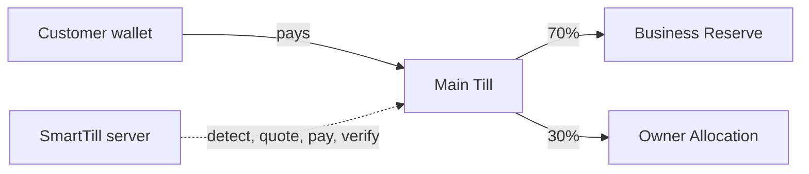

# SmartTill NG

**Your business money, under control.**

SmartTill NG automatically splits every sale a small merchant receives into two separate wallets, a **Business Reserve** for restocking and an **Owner Allocation** for the merchant's own use, using the **Interledger Open Payments API**.

Built for the **Payment Automation and Financial Workflows** track.

- **Live demo:** http://smarttill-ng.vercel.app/
- **Built by:** `Durojaiye Bryan & Oddy WisdomPraise`

> SmartTill runs on the Interledger **test network**. Amounts are in the test wallets' currency, not Naira. Any Naira figure shown in the app is illustrative and labelled as such.

---

## The problem

Many small provision shops, food vendors and market traders in Nigeria receive business revenue straight into a personal bank account. Restocking money and spending money end up mixed together. The owner can't tell how much belongs to the business, how much is safe to withdraw, or what to keep for the next restock.

## The solution

The merchant sets a split once, for example 70% Business Reserve and 30% Owner Allocation. From then on, every sale that lands in the **Main Till** wallet is detected, split and sent on automatically, and each transfer is confirmed before it is shown as done.



## Features

- **Dashboard:** total received, confirmed transfers to each wallet, today's sales, and a picture of the latest sale split.
- **Allocation settings:** presets (80/20, 70/30, 60/40, 50/50) and a slider. The two always total 100%, validated in the browser and again on the server. Changes apply to new sales only.
- **Automatic split:** two separate Open Payments transfers per sale, each verified.
- **Transaction history and receipts:** every sale with a reference, amounts, asset code and scale, time, and the status of each transfer. A printable receipt shows which transfers are confirmed, pending or failed.
- **Honest failure handling:** if one transfer succeeds and the other fails the sale is shown as *Partly completed*. Only confirmed-failed transfers can be retried.
- **WhatsApp receipts (optional):** a summary message after each sale, through Twilio.
- **Profile and Tier 1 verification checklist:** name, phone, shop name, business type and location.
- **Two modes:** real testnet transfers, or a clearly labelled demo simulation.

## How a sale is processed

1. **Detect.** The server lists payments received by Main Till, using the merchant's one-time authorisation. It checks every 20 seconds while the dashboard is open.
2. **Ingest once.** Only completed payments created after the merchant signed up are recorded. A unique database constraint on (merchant, mode, incoming payment URL) makes duplicates impossible.
3. **Snapshot.** The allocation percentages in force at that moment are stored with the sale.
4. **Claim.** The sale moves from `pending` to `processing` in one atomic database update, so two overlapping checks can never process the same sale.
5. **Split.** The amount is split with integer (BigInt) arithmetic in the asset's smallest unit. The owner share is rounded down and the Business Reserve takes the remainder, so the two always add up exactly.
6. **Send, per leg.** For each destination: create an incoming payment on that wallet, create a quote with a fixed debit amount, then create the outgoing payment using the stored grant. The record, quote ID and payment URL are saved before and during each step.
7. **Verify.** The outgoing payment is read back. It counts as completed only when the amount sent equals the amount quoted, and as failed only when the API says so.
8. **Reconcile.** Transfers still in progress are re-checked on later runs and never resent automatically.

Transaction states: `pending`, `processing`, `completed`, `partial`, `failed`. Each transfer also has `skipped` for amounts too small to split.

## Open Payments usage

- Official SDK: `@interledger/open-payments`, server-side only.
- Resources used: wallet addresses, incoming payments, quotes, outgoing payments and grants.
- **Interactive consent:** the merchant approves outgoing payments once at their wallet provider. The grant carries a total spending limit (`GRANT_LIMIT_UNITS`). SmartTill never bypasses consent.
- **Token rotation:** access tokens are short-lived, so the app rotates the stored token before use and saves the new one.
- Unconfirmed outcomes are never treated as failures and never blindly retried.

## Tech stack

Next.js (App Router), React, TypeScript, Tailwind CSS, Supabase (Postgres and Auth), Lucide icons, Vitest, Vercel.

## Security

- Wallet private key, grant tokens, Supabase service key and Twilio credentials exist only on the server. Nothing secret is in client-side code.
- Grant tokens are encrypted at rest with AES-256-GCM. The key is `APP_ENCRYPTION_KEY`.
- Row level security limits each signed-in merchant to their own rows. The `grants` table has no read policy at all.
- All inputs are validated on the server. Every payment step writes to an audit log.
- `.env*` files and the `keys/` folder are git-ignored.

## Getting started locally

### Requirements

- Node.js 20.6 or newer
- A free [Supabase](https://supabase.com) project
- Three wallets on the [Interledger test wallet](https://interledger.org/tech/test-tools/): Main Till, Business Reserve and Owner Allocation. Fund Main Till. Use **separate accounts** if you want to see each balance change in the wallet.
- A key pair created for the Main Till wallet. Save the private key to `keys/main-till.key`.

### 1. Install

```bash
git clone <your-repo-url>
cd smarttill-ng
npm install --legacy-peer-deps
```

### 2. Create the database

In the Supabase SQL Editor, run these files from `supabase/`, in this order:

1. `schema.sql`
2. `migration-whatsapp.sql`
3. `migration-profile.sql`

In Supabase, go to Authentication, then Sign In / Providers, then Email, and turn **off** "Confirm email" so sign-up works instantly.

### 3. Configure

Copy `.env.example` to `.env.local` and fill it in (see the table below). Generate the encryption key with:

```bash
node -e "console.log(require('crypto').randomBytes(32).toString('hex'))"
```

### 4. Run

```bash
npm run dev
```

Open http://localhost:3000, then:

1. Create an account.
2. Go to **Wallets** and click **Authorise transfers**. Approve at the wallet provider.
3. Send a test payment into Main Till from another test wallet account.
4. Watch it appear on the dashboard and split into the two wallets.

### 5. Test

```bash
npx vitest run
```

26 unit tests cover the money logic: 70/30, 60/40 and 50/50 splits of 10,000 units, invalid and non-100 percentages, rounding and asset scale, duplicate and concurrent processing, one transfer failing, both failing, an unconfirmed transfer that must not be marked failed, and retrying only the failed transfer. The Open Payments integration itself is verified by running real transfers on the testnet, not by unit tests.

## Environment variables

| Variable | Required | Purpose |
|---|---|---|
| `NEXT_PUBLIC_SUPABASE_URL` | Yes | Supabase project URL, like `https://xxxx.supabase.co` with nothing after it |
| `NEXT_PUBLIC_SUPABASE_ANON_KEY` | Yes | Supabase public key |
| `SUPABASE_SERVICE_ROLE_KEY` | Yes | Supabase secret key. Server only |
| `MAIN_TILL_WALLET_URL` | Yes | Main Till wallet address URL |
| `RESERVE_WALLET_URL` | Yes | Business Reserve wallet address URL |
| `OWNER_WALLET_URL` | Yes | Owner Allocation wallet address URL |
| `MAIN_TILL_KEY_ID` | Yes | Key ID registered for the Main Till wallet |
| `MAIN_TILL_PRIVATE_KEY_PATH` | Local | Path to the private key file, for example `./keys/main-till.key` |
| `MAIN_TILL_PRIVATE_KEY_B64` | Vercel | Base64 of the private key file contents. Used instead of the path when hosted |
| `APP_ENCRYPTION_KEY` | Yes | 64 hex characters. Encrypts stored grant tokens. Keep it the same across deployments |
| `APP_MODE` | No | `testnet` (default) or `demo` |
| `GRANT_LIMIT_UNITS` | No | Total the merchant authorises, in whole units of the Main Till asset. Default 1000 |
| `ILLUSTRATIVE_NGN_PER_UNIT` | No | Naira per test unit, for the labelled illustrative figure. Default 1500 |
| `TWILIO_ACCOUNT_SID` | Optional | WhatsApp alerts |
| `TWILIO_AUTH_TOKEN` | Optional | WhatsApp alerts |
| `TWILIO_WHATSAPP_FROM` | Optional | WhatsApp sender number from the Twilio console |

To create `MAIN_TILL_PRIVATE_KEY_B64` on Windows PowerShell:

```powershell
[Convert]::ToBase64String([IO.File]::ReadAllBytes("keys/main-till.key"))
```

## Modes

| Mode | Behaviour |
|---|---|
| `testnet` | Real Open Payments operations between your test wallets. Nothing is simulated or faked. If a payment fails it is shown as failed. |
| `demo` | Synthetic sales, flagged **Demo** everywhere, stored separately from testnet records. No money moves. Use only as a fallback and say so. |

The app never falls back from testnet to demo on its own.

## WhatsApp alerts (optional)

Uses the Twilio WhatsApp Sandbox.

1. Create a Twilio account and open Messaging, then Try it out, then Send a WhatsApp message.
2. From the phone that will receive alerts, send the `join ...` message shown to the sandbox number.
3. Add the three `TWILIO_*` variables and restart or redeploy.
4. In **Settings**, save the number and press **Send test alert**.

The sandbox only allows free-text messages within 24 hours of the receiving phone's last message to the sandbox. Send any message to it shortly before a demo. A production setup would use an approved WhatsApp Business sender and message templates.

Each sale sends at most one alert. If WhatsApp is not configured, everything else works as normal.

## Deploying to Vercel

1. Push the repository to GitHub.
2. In Vercel, choose **Add New**, then **Project**, and import the repository.
3. Add the environment variables from the table above. Use `MAIN_TILL_PRIVATE_KEY_B64` and leave out `MAIN_TILL_PRIVATE_KEY_PATH`.
4. Deploy, then repeat the steps in "Run" on the live URL. Accounts and authorisations are separate from local ones.

`next.config` lists the Open Payments packages as external and includes the library's spec files in the serverless bundle. Without this, hosted requests fail with a missing `.yaml` file error. Changing environment variables only takes effect after a redeploy.

## Project structure

```
src/
  app/
    (app)/            Dashboard, Transactions (and receipt), Allocation, Wallets, Settings
    api/              sync, retry, grant/start, grant/callback, allocation, profile, whatsapp, demo/sale
    login/            Sign in and sign up
  components/         Interface components
  lib/
    allocation.ts     Percentage validation, exact split, status aggregation
    processor.ts      Payment orchestration, duplicate protection, failure handling
    money.ts          Amount formatting by asset scale
    openpayments/     SDK client, grants, quotes, outgoing payments
    payments/sync.ts  Detect, ingest, process, reconcile, retry
    notify*.ts        WhatsApp message and sending
    kyc.ts            Tier 1 checklist
    crypto.ts         Token encryption
    supabase/         Server, admin and browser clients
supabase/             schema.sql and migrations
```

## Known limitations

- **No balances.** Open Payments has no balance lookup. The dashboard shows transfers SmartTill has confirmed, labelled that way. Check each test wallet for its live balance. If your three wallets are addresses under one account, the account balance will not appear to change.
- **Polling, not webhooks.** Wallet providers send webhooks to themselves, not to client apps, so SmartTill checks every 20 seconds while the dashboard is open, or on demand. A hosted scheduled job would remove the need to keep the page open.
- **One wallet set.** In this MVP the three wallets come from environment variables and are shared by every account. Real multi-merchant use needs per-merchant wallets and credentials.
- **Spending cap.** Authorisation covers a total limit. When it is used up or revoked, the merchant re-authorises on the Wallets page.
- **Interrupted runs.** If a server function is cut off mid-payment, that transfer stays in *Processing* for manual checking instead of being resent.
- **Tier 1 is self-declared.** Name, phone, business and location are not verified. ID verification (BVN or NIN) needs a licensed partner and is not connected.
- **Build setting.** The project sets `typescript.ignoreBuildErrors` so type errors do not block deployment. It should be removed and any errors fixed before production.

## Troubleshooting

| Symptom | Fix |
|---|---|
| "Invalid path specified in request URL" at sign-in | `NEXT_PUBLIC_SUPABASE_URL` has extra text. It must end at `.supabase.co`. Restart after changing |
| Missing `wallet-address-server.yaml` | Check the `serverExternalPackages` and `outputFileTracingIncludes` settings in `next.config` |
| "missing required request field 'interact'" | Re-authorise on the Wallets page so the grant includes permission to read incoming payments |
| Sales are detected but not split | Authorise transfers on the Wallets page |
| A sale never appears | It must be sent to the Main Till address after your account was created, and be marked complete by the wallet |
| WhatsApp message not received | Message the sandbox number within the last 24 hours and check the sender number |

## Roadmap

Scheduled background checks, per-merchant wallets, BVN and NIN verification, spending reports, and WhatsApp Business templates.

## Acknowledgements

Built with the [Open Payments](https://openpayments.dev/) standard and the Interledger test network.
